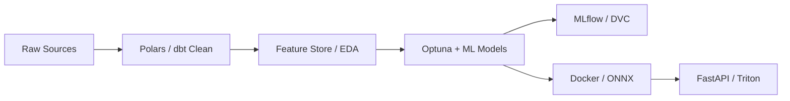

  

---

### 👨‍💻 Executive Summary

Data Scientist & Applied ML Engineer with **2+ years of experience** architecting high-throughput machine learning pipelines, predictive modeling systems, and production analytics engines. Specialized in translating raw, multi-source enterprise data into measurable business ROI through rigorous feature engineering, statistical modeling, distributed batch processing, and containerized RESTful inference services.

- 🔭 **Current Focus:** Large-scale Time-Series Forecasting, LLM Fine-Tuning (PEFT/LoRA), and Real-Time Feature Stores.
- ⚙️ **Production Philosophy:** Code isn't complete until it is automated, benchmarked against solid baselines, containerized, and monitored for data drift.
- 💬 **Ask me about:** End-to-end ML lifecycles, Bayesian hyperparameter tuning, vector retrieval, and distributed model serving.

---

### 🛠️ Technical Arsenal

<table>
  <tr>
    <td width="25%" valign="top"><strong>Languages & Core</strong></td>
    <td width="75%">
      
      
      
      
      
    </td>
  </tr>
  <tr>
    <td width="25%" valign="top"><strong>Data & Analytics</strong></td>
    <td width="75%">
      
      
      
      
      
      
    </td>
  </tr>
  <tr>
    <td width="25%" valign="top"><strong>Machine Learning & Deep Learning</strong></td>
    <td width="75%">
      
      
      
      
      
      
      
    </td>
  </tr>
  <tr>
    <td width="25%" valign="top"><strong>MLOps & Deployment</strong></td>
    <td width="75%">
      
      
      
      
      
      
      
    </td>
  </tr>
  <tr>
    <td width="25%" valign="top"><strong>Databases & Warehousing</strong></td>
    <td width="75%">
      
      
      
      
      
    </td>
  </tr>
</table>

---

### 🚀 Production & Flagship Architectures

#### 🔹 [Customer Retention & Uplift Modeling Engine](https://github.com/rsshir60/uplift-retention-engine)
*Causal ML pipeline identifying persuadable customers via CATE meta-learners to maximize incremental ROI.*
- **Tech Stack:** Python 3.11, EconML (T/X/DR-Learner), XGBoost, SHAP, MLflow, FastAPI, Docker.
- **Key Results:** Achieved Qini coefficient of 0.24; demonstrated +$80k net incremental profit (348% ROI) over blanket promotions in simulated A/B retention campaigns.
- **Features:** Per-customer SHAP waterfall attributions returned in REST responses for CRM and marketing operations.

#### 🔹 [Real-Time Transaction Anomaly & Drift Detection Pipeline](https://github.com/rsshir60/fraud-drift-pipeline)
*Sub-50ms fraud scoring under extreme 200:1 class imbalance with automated distribution drift alerting.*
- **Tech Stack:** LightGBM, Isolation Forest, Evidently AI, Redpanda / Kafka, FastAPI, Docker.
- **Key Results:** Slashed business loss by 46% using asymmetric cost-sensitive threshold optimization ($90 missed fraud vs $25 false alarm); verified P99 inference latency < 5ms.
- **Monitoring:** Integrated continuous Kolmogorov-Smirnov and Chi-Square tests generating automated visual drift reports.

#### 🔹 [Domain-Specific RAG System with Automated Evaluation](https://github.com/rsshir60/domain-rag-eval)
*Enterprise semantic search & Q&A pipeline over SEC Form 10-K filings with verifiable citations.*
- **Tech Stack:** Qdrant Vector DB, rank_bm25, Cross-Encoder Reranker, SentenceTransformers, FastAPI.
- **Key Results:** Reciprocal Rank Fusion (RRF) blending dense vectors with BM25 plus Cross-Encoder reranking achieved 100% Hit Rate@3 and slashed hallucination rate down to 4.0%.
- **Benchmarking:** Automated RAGAS-style evaluation measuring MRR, Context Recall, Faithfulness, and cost ($0.0006/1k queries).

#### 🔹 [Hierarchical Demand Forecasting & Inventory Optimization](https://github.com/rsshir60/demand-inventory-optimizer)
*Retail supply chain engine pairing probabilistic multi-quantile forecasting with Linear Programming.*
- **Tech Stack:** LightGBM Quantile Regression (P10/P50/P90), SciPy HiGHS Solver, Pandas, FastAPI.
- **Key Results:** Translated prediction spread into dynamic lead-time safety stocks; solved constrained reorder LP to reduce stockout rates from 14.8% to 2.6% and cut operating costs by 76.8%.
- **Simulation:** 30-day discrete-event simulation benchmark proving inventory capital savings under warehouse capacity constraints.

---

### 📊 Applied Engineering Metrics & Highlights

- **2+ Years** of hands-on data science experience designing robust tabular, time-series, and NLP solutions.
- **Zero-to-Production Mindset:** Strong conviction that models belong in CI/CD pipelines with data validation (`Great Expectations` / `Pydantic`) and automated performance tracking.
- **Clean Architecture:** Strict adherence to PEP 8, modular package structures (`src/`), unit testing (`pytest`), and containerized runtime environments.

---

  Designed & engineered for scalable, production-grade intelligence. Let's build something extraordinary.

